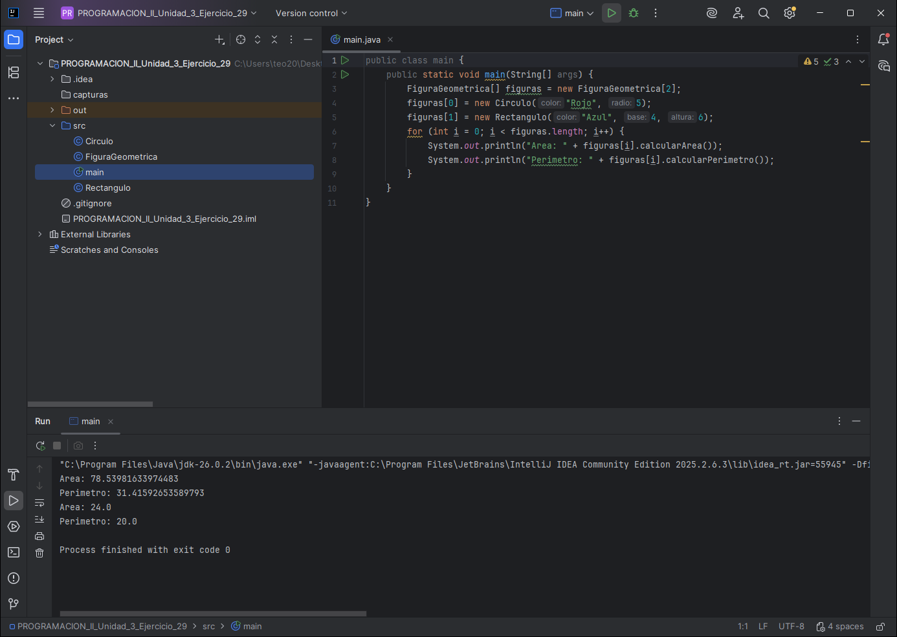

# PROGRAMACIÓN II — Unidad 3, Ejercicio 29: Figuras Geométricas y Cálculo de Superficies

Trabajo práctico de Programación II. Este repositorio contiene la resolución en Java del ejercicio 29 de la Unidad 3.

## Consigna

#### Contexto

En una aplicación de diseño gráfico vectorial, se manipulan diversas figuras geométricas. Aunque todas comparten la propiedad de tener un color de borde y una posición en el plano, el cálculo matemático del área y el perímetro cambia radicalmente dependiendo de si se trata de un círculo, un rectángulo o un triángulo.

#### Consigna

Modelar una jerarquía de clases en Java aplicando herencia para calcular las propiedades geométricas de distintas figuras a partir de un concepto base.

#### Desarrollo requerido

- Definir la clase base FiguraGeometrica con atributos comunes como color y métodos orientados al cálculo matemático.
- Crear clases hijas como Circulo (con atributo radio) y Rectangulo (con atributos base y altura).
- Sobrescribir métodos específicos en las subclases para calcular el área y el perímetro aplicando las fórmulas matemáticas correspondientes.
- En el método main, instanciar figuras geométricas específicas, invocar los cálculos matemáticos e imprimir los resultados formateados por consola.

## Estructura del repositorio

```
PROGRAMACION_II_Unidad_3_Ejercicio_29/
├── README.md
├── capturas/
│   └── consola.png
└── src/
    ├── Circulo.java
    ├── FiguraGeometrica.java
    ├── main.java   # clase con el método main
    └── Rectangulo.java
```

## Funcionamiento y lógica

El ejercicio aplica **herencia y polimorfismo** para calcular el área y el perímetro de distintas figuras con los mismos métodos.

### `FiguraGeometrica` (clase base)

Tiene un `color` (`protected`) y los métodos `calcularArea()` y `calcularPerimetro()`, que en la clase base devuelven 0 y cada figura redefine.

### `Circulo`

Agrega el `radio` y sobrescribe los dos métodos usando `Math.PI`:

- **Área:** π × r².
- **Perímetro:** 2 × π × r.

### `Rectangulo`

Agrega `base` y `altura`:

- **Área:** base × altura.
- **Perímetro:** 2 × (base + altura).

### `main`

Crea un arreglo `FiguraGeometrica[]` con un círculo rojo de radio 5 y un rectángulo azul de 4 × 6, y lo recorre mostrando el área y el perímetro de cada uno:

- **Círculo:** área ≈ 78.54 y perímetro ≈ 31.42.
- **Rectángulo:** área 24 y perímetro 20.

## Ejecución

Captura de la consola de IntelliJ IDEA ejecutando el programa:



Salida obtenida:

```
Area: 78.53981633974483
Perimetro: 31.41592653589793
Area: 24.0
Perimetro: 20.0
```
